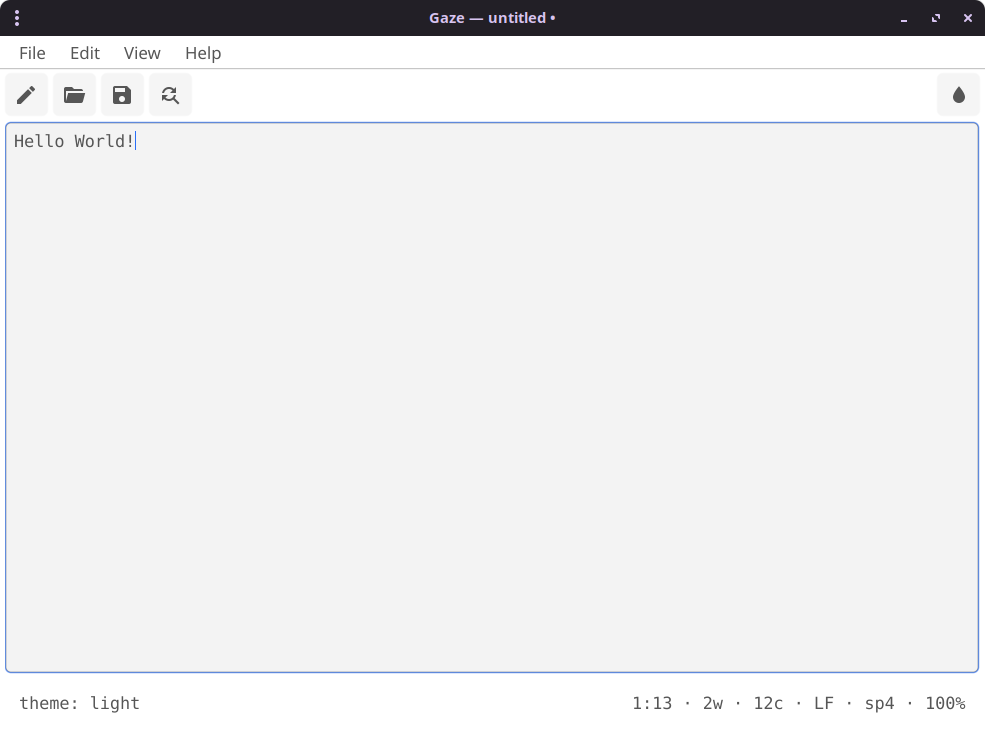
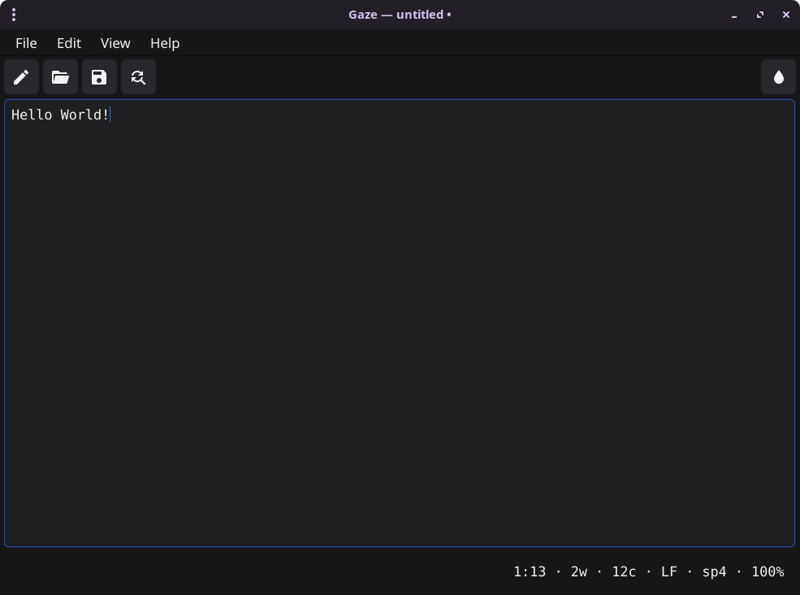

# Gaze — a tiny, fast text editor

[](https://github.com/AmirrezaSaadi/gaze-editor/actions/workflows/ci.yml)

A small, keyboard-first text editor built with [Fyne](https://fyne.io).
Monospaced editing surface, stock **Light** and **Dark** themes, and only the
day-to-day features you actually reach for — no plugin system, no bloat.

## Screenshots

| Light theme | Dark theme |
| :---: | :---: |
| [](screenshots/light.png) | [](screenshots/dark.png) |

## Features

- **File** — New, Open, Save, Save As, native dialogs, unsaved-changes guard
- **Atomic save** — writes a synced temp file and renames it over the target,
  preserving permissions (and symlinks) so a crash cannot truncate your file
- **Autosave recovery** — dirty buffers are snapshotted to the cache dir and
  offered back after a crash, untitled buffers included
- **One editing surface for every file size** — the text lives in a 64 KB page
  store with a byte-offset line index, and Gaze draws the lines on screen
  itself, so a 24 MB / 600k-line file opens in about 80 ms using ~5 MB of heap
  and costs the same to type in as a shopping list. Wrap, selection, undo,
  find/replace across the whole file, crash recovery and saving all behave the
  same at any size; over 16 MiB Gaze asks first, and over 256 MiB it refuses
- **Save guard** — a save warns when the file was changed on disk since it was
  opened, rather than overwriting it silently
- **Session restore** — reopen the last file and caret position on a bare launch
- **Drag & drop** a file onto the window to open it
- **Recent files** — persisted list (max 10) under *File → Open Recent*
- **Find & replace** — next with wrap-around, match-case, **regex** (with `$1`
  capture groups), and a persisted **search history** (`Alt+Up` / `Alt+Down`);
  works across a whole large file, not just the visible window
- **Go to line** — jump straight to a line number, or `file:line:col` on the CLI
- **Line operations** — indent/outdent, move line up/down, duplicate line
- **Trim trailing whitespace on save** (optional, persisted)
- **Line-ending aware** — CRLF/CR files are normalised for editing and restored
  on save; the convention is shown in the status bar
- **Encoding aware** — UTF-8, UTF-8 with BOM and UTF-16 (LE/BE) are detected and
  written back in their original form; binary files and UTF-32 are refused
  instead of being corrupted on save
- **Undo / redo** covering typing *and* the whole-buffer commands (line
  operations, replace all), **cut / copy / paste**, **select all**
- **Word wrap** toggle (persisted), word-aware, at any file size
- **Font zoom** in/out/reset (persisted)
- **Tooltips** — hover any toolbar or find-bar button to see what it does
- Live status bar: `line:col · words · chars · EOL · indent · zoom` — counted in
  the background for big files, so the numbers never block typing
- Window size, theme and preferences persisted between runs

## Command line

```
gaze [options] [file[:line[:col]]]

  -h, --help        show help
  -v, --version     print version
  -                 read a buffer from standard input
```

Opening a file, positioning at a line, or piping into `gaze` is first-class:

```sh
gaze notes.txt
gaze main.go:120          # open at line 120
gaze main.go:120:8        # …and column 8
gaze draft.md             # a path that does not exist yet is created on save
git diff | gaze           # piped stdin is loaded automatically
```

## Shortcuts

| Action                     | Shortcut                                |
| -------------------------- | --------------------------------------- |
| New / Open / Save          | `Ctrl+N` / `Ctrl+O` / `Ctrl+S`          |
| Save As                    | `Ctrl+Shift+S`                          |
| Find & replace             | `Ctrl+F`                                |
| Find history               | `Alt+Up` / `Alt+Down`                   |
| Go to line                 | `Ctrl+G`                                |
| Close find bar             | `Esc`                                   |
| Undo / Redo                | `Ctrl+Z` / `Ctrl+Y`                     |
| Cut / Copy / Paste         | `Ctrl+X` / `Ctrl+C` / `Ctrl+V`          |
| Select all                 | `Ctrl+A`                                |
| Indent / Outdent           | `Ctrl+]` / `Ctrl+[`                     |
| Move line up / down        | `Ctrl+Shift+Up` / `Ctrl+Shift+Down`     |
| Duplicate line             | `Ctrl+Shift+D`                          |
| Zoom in / out / reset      | `Ctrl+=` / `Ctrl+-` / `Ctrl+0`          |
| Quit                       | `Ctrl+Q`                                |

## Layout

```
Gaze/
  cmd/gaze/main.go        # CLI parsing (file:line:col) + entry point
  internal/editor/
    editor.go             # window wiring, slim toolbar, menus, status, theme
    fileops.go            # file I/O (atomic), recent files, session, geometry
    find.go               # find & replace (literal + regex), history, go-to-line
    autosave.go           # crash-recovery snapshots (streamed from the document)
    document.go           # 64 KB page store, line index, windowed reads
    codeview.go           # the editing surface: drawing, caret, selection, undo
    encoding.go           # UTF-8/UTF-16 detection and byte-order marks
    text.go               # rune/offset/text helpers, line ops, EOL + indent
    tooltip.go            # hover tooltips for toolbar/find-bar buttons
  internal/theme/theme.go # Light/Dark selection, font zoom, persistence
  Icon.png                # app icon, rendered from packaging/icon.svg
  packaging/gaze.desktop  # freedesktop launcher for `make install`
  packaging/icon.svg      # icon artwork; `make icon` re-renders Icon.png
```

## Run / build / install

```sh
make run                        # go run ./cmd/gaze
make run ARGS="notes.txt"       # …with a file argument
make build                      # stripped, size-optimised binary -> ./gaze
make release                    # build, then UPX-compress if upx is installed
make install                    # -> ~/.local/bin + ~/.local/share/applications
make test                       # go test ./...
make vet                        # go vet ./...
```

`make build` uses `-trimpath`, `-ldflags "-s -w -buildid="` and the
`no_emoji,no_animations` tags. `no_emoji` drops Fyne's bundled 4 MB emoji font
(the system one is used instead) and `no_animations` skips cursor-blink and tap
animations, saving a little more code and CPU. This keeps the binary around
**20 MB** instead of the ~33 MB a default `go build` produces; what remains is
the Go runtime plus Fyne's GL driver and bundled text fonts.

## Size & memory notes

- No duplicate buffer: dirty state is a flag, not a second copy of the file.
- Only ~35 `canvas.Text` objects exist no matter how big the file is: scrolling
  moves them, so cost tracks the screen, not the document. Re-drawing a page
  costs ~0.3 ms; a keystroke in a 600k-line file costs ~1.4 ms because the line
  index shifts in place instead of being rebuilt.
- File loads stream through a `strings.Builder`; saves stream the document's
  pages straight to disk, so neither builds a full-size `[]byte` or string copy.
- Word and character counts of a big document are computed off the UI goroutine
  (debounced), and its crash-recovery snapshots are streamed page by page.
- `runtime/debug.FreeOSMemory` runs after open/save so the resident set does
  not creep up as files are cycled.
- `debug.SetGCPercent(50)` keeps the idle heap small.
- The UI is deliberately slim: a five-button toolbar, a two-row find bar and a
  compact status line — no extra chrome, no placeholder text.

## Known limitations (Fyne)

- **No IME composition.** Gaze's editing surface is drawn by Gaze, so a
  composing input method (CJK, some keyboard layouts) cannot attach to it the way
  it attaches to `widget.Entry`; typed runes are inserted directly.
- Tabs are expanded to the editor's indent width for display, so a file that
  mixes tabs and spaces lines up by column, not by tab stop.
- **Find/replace materialises the document once per command**, because `^`, `$`
  and `$1` need the whole text. It is released as soon as the command finishes.
- The line commands (indent, move, duplicate) act on the caret's line; there is
  no block indent over a multi-line selection yet.
- Large-file mode (over 16 MiB) keeps trailing whitespace: trimming on save
  would have to rewrite the whole document to mirror it back into the buffer.
- Files over 256 MiB are refused rather than loaded.
- BOM-less UTF-16 is detected and refused with an explanatory message rather
  than decoded, because guessing the byte order of an unmarked file is not safe.

## Changes

See [CHANGELOG.md](CHANGELOG.md) for what changed in each release.

## License

MIT — see [LICENSE](LICENSE).
